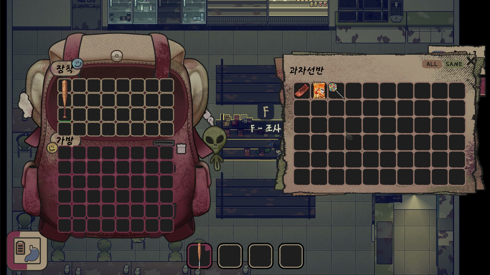

# 장대한 · Unity 게임 클라이언트 프로그래머

Unity와 C#으로 게임의 입력, 상태 변화, 진행 규칙을 구현합니다. 팀 프로젝트에서 담당한 코드를 **플레이 맥락 → 설계 판단 → 관련 소스** 순서로 정리했습니다.

[포트폴리오 요약 PDF · 5쪽](docs/JANG_DAE_HAN_Game_Client_Portfolio.pdf) · [소스·설명·시연 자료 ZIP](https://knugame.kr/2026/wp-content/uploads/2026/11/jang-daehan-game-client-samples-v2.zip)

## 먼저 볼 구현

**Azit의 비정형 인벤토리**: 아이템 그림과 점유 칸을 분리하고, 배치 검사와 실제 이동을 나눠 처리했습니다. 대상 배치가 실패하면 원래 배치로 복원을 시도하는 경로도 함께 다룹니다.

[설명 읽기](projects/azit/README.md) · [배치 검사 코드](src/azit/ItemGridCore.cs#L94) · [이동 처리 코드](src/azit/ItemTransferTransaction.cs#L37) · [루팅 플레이 영상](https://knugame.kr/2026/wp-content/uploads/2026/11/azit-inventory-looting.mp4)

*영상은 선반 조사와 아이템 수집·가방 변화를 보여 줍니다. 회전 배치와 이동 실패 흐름은 연결한 코드에서 확인할 수 있습니다.*

## 프로젝트별 확인 지점

| 프로젝트 | 팀과 역할 | 중점적으로 볼 구현 | 설명 |
| --- | --- | --- | --- |
| **Azit** · 2D 생존 RPG | 4인 · 프로그래밍 1명 | 회전된 점유 셀 검사, 아이템 이동의 완료·복원 경로 | [인벤토리 사례](projects/azit/README.md) |
| **BOXXHOOTER** · 3D 액션 슈팅 | 4인 · 프로그래밍 1명 | 체력별 패턴 선택, 개별 공격의 실행 생명주기 | [보스 패턴 사례](projects/boxxhooter/README.md) |
| **BoomBeat** · 8방향 리듬 게임 | 3인 · 프로그래밍 2명 중 1명 | 곡 데이터 기반 생성, 거리 판정과 후보 상태, 노트 재사용 | [생성·판정 사례](projects/boombeat/README.md) |
| **THE KEYNG** · 2D 계층 퍼즐 | 3인 · 프로그래밍 1명 | 바로 위층으로 입력 전달, 한 칸 이동과 유지 입력 구분 | [층간 입력 사례](projects/the-keyng/README.md) |

프로젝트의 그래픽·기획과 프로그래밍은 팀이 나눠 맡았습니다. 각 설명의 역할 표기에 본인이 담당한 범위를 구분했습니다.

## 저장소를 읽는 방법

- 각 사례의 **코드 읽기 시작점**에서 파일과 메서드를 먼저 확인할 수 있습니다.
- `src/`는 원본 프로젝트에서 선별한 소스 파일입니다. 씬·프리팹·게임 데이터와 외부 에셋 의존성이 있어, 이 저장소만으로 게임을 실행하는 구성은 아닙니다.
- `media/`에는 시연에 사용한 이미지와 짧은 영상 사본이 있습니다. 학교 서버의 재생 링크와 같은 장면을 보관했습니다.
- 원본의 상대 경로와 공개 사본의 대응은 [소스 맵](docs/source-map.json)에 정리했습니다. 코드 본문은 유지하고 GitHub에서 한글 주석을 읽을 수 있도록 인코딩과 줄바꿈을 정규화했습니다. 보스 패턴 사본 한 개는 기존 클래스명과 파일명을 맞췄습니다.

## 작업과 확인 범위

개발과 문서 정리에 AI 도구를 활용했습니다. 설명은 실제 원본 코드와 기획·발표 자료를 대조해 작성했으며, 각 사례에 코드와 시연으로 확인한 범위를 적었습니다.

## 연락처

- **JANG DAE HAN** · [wkdeogks0729@gmail.com](mailto:wkdeogks0729@gmail.com)
- [졸업전시 프로필](https://knugame.kr/2026/students/jang-daehan/)

