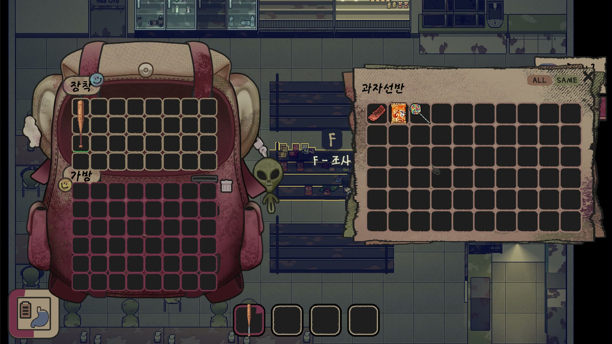
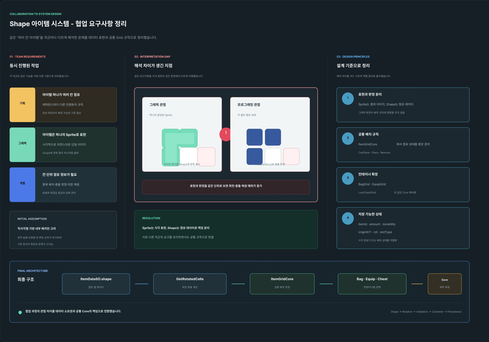

# Azit · 아이템 모양과 이동 상태를 다루는 인벤토리

도시를 탐색하며 자원을 모으고 장비를 만드는 2D 탑다운 생존 RPG입니다. 모양이 다른 아이템을 회전해 가방에 넣고, 루팅 상자와 가방 사이로 옮기는 흐름을 다룹니다.

| 항목 | 내용 |
| --- | --- |
| 팀 | 4인 · 기획 1 / 그래픽 2 / 프로그래밍 1 |
| 내 역할 | 프로그래밍. 이 사례에서는 인벤토리의 점유 셀 검사와 이동 처리에 집중합니다. |
| 기술 | Unity 2022.3.62f2 · C# |

[루팅 플레이 · 약 7초](https://knugame.kr/2026/wp-content/uploads/2026/11/azit-inventory-looting.mp4) · [동일 영상 파일](../../media/azit-looting.mp4) · [전체 프로젝트 목록](../../README.md)

## 다룬 문제와 설계

**아이템 그림의 크기만으로는 실제로 차지하는 칸을 표현하기 어렵습니다.** 표시할 스프라이트와 점유할 셀 목록인 Shape를 나누고, 회전된 셀마다 기준 좌표를 더해 사용할 수 있는 칸인지 검사했습니다. 가방·장비·상자처럼 화면이 달라도 같은 판정 규칙을 사용할 수 있는 구조입니다.

**놓을 수 있는지 검사하는 단계와 실제 저장소를 옮기는 단계도 나눴습니다.** `ItemGridCore`는 셀 사용 가능 여부와 다른 아이템의 점유를 검사합니다. `ItemTransferTransaction`은 원본 제거와 대상 배치를 진행하고, 대상 배치가 실패하면 복원 콜백을 호출합니다.

| 경계조건 | 코드에서 확인할 동작 |
| --- | --- |
| 회전한 모양 일부가 사용 불가 셀에 걸림 | 각 점유 셀의 사용 가능 여부를 검사해 배치를 거절합니다. |
| 다른 아이템과 겹침 | 검사에서 제외한 아이템 외의 점유가 있으면 거절합니다. |
| `TryMove`에서 원본 제거 실패 | 대상 배치를 진행하지 않고 실패를 반환합니다. |
| `TryMove`에서 대상 배치가 `false` 반환 | `Rollback()`으로 원래 배치 복원을 시도합니다. |

## 코드 읽기 시작점

1. [CanPlaceIgnoring · ItemGridCore.cs](../../src/azit/ItemGridCore.cs#L94) — 회전한 Shape, 사용 가능 셀, 점유 충돌 검사.
2. [TryMove](../../src/azit/ItemTransferTransaction.cs#L37)와 [Rollback](../../src/azit/ItemTransferTransaction.cs#L112) — 이동 완료 조건과 복원 시점.

배치 규칙을 바꿀 때와 이동 실패 처리를 바꿀 때의 수정 위치를 구분한 것이 핵심입니다. 셀 검사는 Shape의 셀 수만큼 수행합니다.

## 확인 범위와 다음 검토

시연 영상은 선반 조사와 아이템 수집·가방 변화를 보여 주는 원본 플레이 구간입니다. 회전 배치와 이동 실패 흐름은 위 코드에서 확인할 수 있습니다. `Rollback`은 원래 배치 복원을 시도하며, 복원 콜백의 실패 가능성도 남아 있습니다.

공개한 두 파일은 `ItemInstance`, 컨테이너 인터페이스, 아이템 유틸리티 등 원본 프로젝트의 타입에 의존하는 선별 소스입니다.

