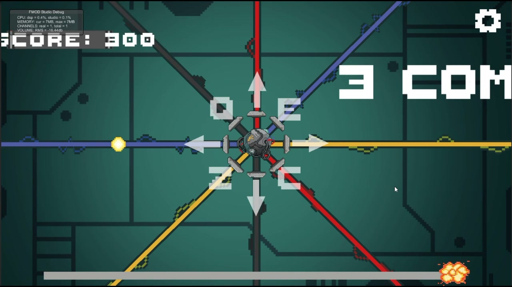
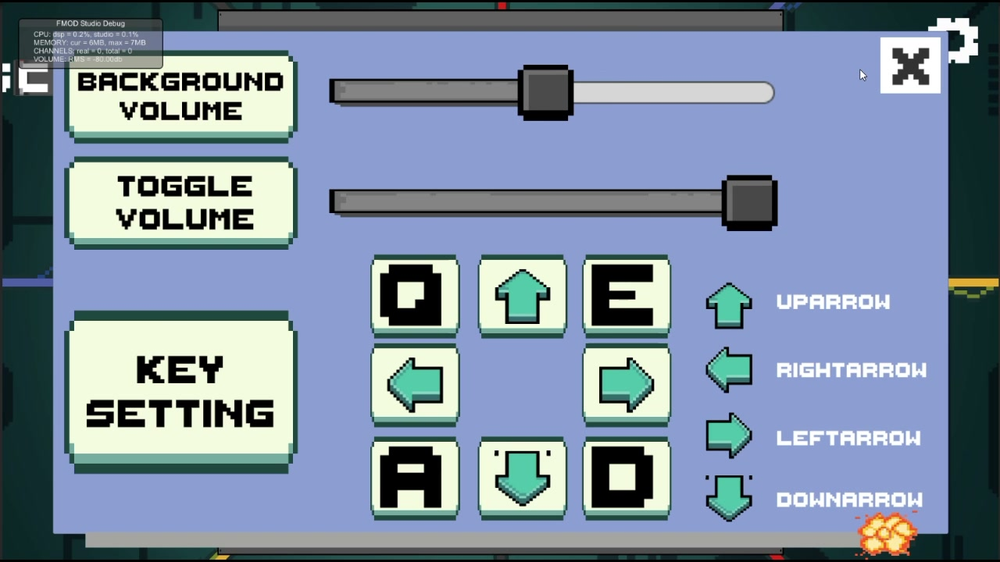

# BoomBeat · 노트 생성 시계와 입력 판정을 구분하기

여덟 방향에서 중앙으로 다가오는 노트를 보고 방향별 입력 키를 누르는 리듬 게임입니다. 발표자료의 공식 영문 표기는 **BoomBeat**입니다.

| 항목 | 내용 |
| --- | --- |
| 팀 | 3인 · 프로그래밍 2명(기획 겸임 1명) / 그래픽 1명 |
| 내 역할 | 프로그래밍 2명 중 1명. 이 저장소에서 설명·공개한 범위는 노트 생성·이동, 거리 기반 판정, 일반·롱 노트 재사용입니다. |
| 기술 | Unity · C# · 곡별 JSON 데이터 |

[발표자료의 실제 플레이 · 약 11초](https://knugame.kr/2026/wp-content/uploads/2026/11/boombeat-gameplay.mp4) · [동일 영상 파일](../../media/boombeat-gameplay.mp4) · [전체 프로젝트 목록](../../README.md)

발표자료의 실제 설정 화면입니다. 팀 프로젝트의 입력 구성을 보여 주며, 아래에서는 노트 생성·판정·재사용 코드를 설명합니다.

## 다룬 문제와 설계

노트를 언제 만들지와 입력을 어떤 결과로 평가할지는 다른 기준이 필요합니다. 생성은 곡 데이터의 도착 시각에서 미리 생성할 시간을 뺀 시점에 맞추고, 일반 노트의 입력 판정은 판정점과 노트 사이의 거리로 나눴습니다.

| 처리 | 실제 기준 |
| --- | --- |
| 생성 시계 | `Time.time - songStartTime` |
| 생성 조건 | 곡 데이터의 노트 시각에서 `noteArrivalOffset`을 뺀 값과 비교 |
| 입력 판정 | 트리거 구역의 미처리 후보를 확인하고 판정점까지의 거리로 Perfect·Good 분기 |
| 후보 퇴장 | 후보 목록에서 제거하고, 아직 미처리 상태인 노트만 Miss 처리 |
| 재사용 | 일반·롱 노트 두 유형의 풀에서 노트를 꺼내 사용하고 반환 경로를 관리 |

후보 목록에 있다는 사실과 이미 판정이 끝났다는 상태를 함께 검사합니다. 같은 입력으로 여러 후보가 처리되지 않도록 하나를 적중시키면 이번 검사를 끝내고, 허용 거리 밖인 후보는 완료 처리하지 않은 채 다음 후보를 확인합니다.

## 코드 읽기 시작점

1. [NoteGenerator.Start](../../src/boombeat/NoteGenerator.cs#L21)와 [SpawnNotes](../../src/boombeat/NoteGenerator.cs#L45) — JSON 데이터, 생성 시계, 도착 오프셋과 레인 배치.
2. [HitZone.TryHitNote](../../src/boombeat/HitZone.cs#L71)와 [OnTriggerExit2D](../../src/boombeat/HitZone.cs#L49) — 거리 판정·구역 퇴장과 노트 상태.
3. [NotePool.GetNote](../../src/boombeat/NotePool.cs#L87)와 [ReturnNote](../../src/boombeat/NotePool.cs#L114) — 일반·롱 노트의 재사용과 반환 관리.

## 확인 범위와 다음 검토

영상에서 확인할 수 있는 것은 노트 접근, 입력에 따른 점수·콤보 변화입니다. Perfect·Good 텍스트 자체를 보여 주는 영상으로 설명하지 않았습니다.

거리 판정에서는 일정한 속도로 접근할 때도 노트가 빠를수록 같은 거리 허용값의 시간 폭이 짧아집니다. 음악 출력 지연 보정이나 속도별 동일한 시간 판정 폭은 이 포트폴리오에서 검증한 성과가 아닙니다. 다음 검토 대상은 생성 시계와 음악 재생 시각의 연결, 속도별 허용 폭입니다.

생성기는 Newtonsoft JSON 패키지와 원본의 노트 타입·프리팹에 의존합니다.

