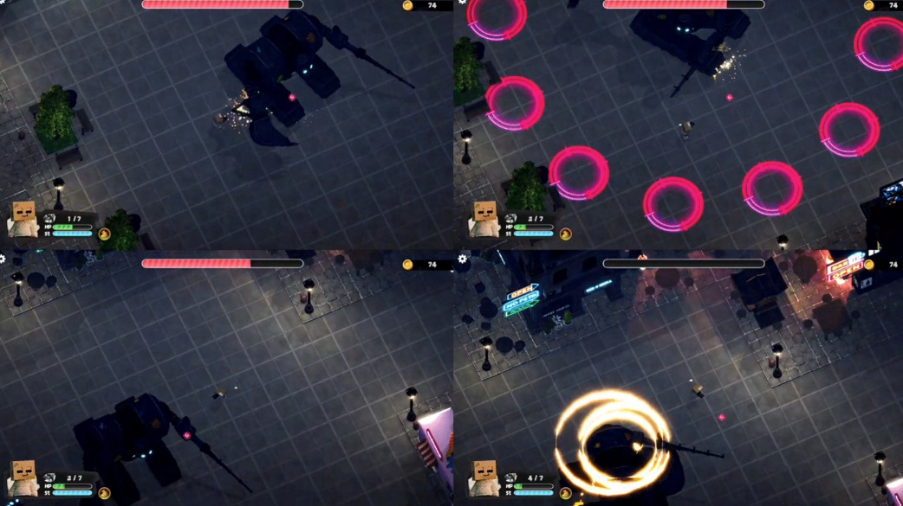

# BOXXHOOTER · 보스의 공격 선택과 실행을 나누기

전투와 퍼즐을 거쳐 보스에 도전하는 3D 쿼터뷰 액션 슈팅입니다. 이 사례에서는 보스 체력에 따른 패턴 선택과 개별 공격의 실행·종료를 어떻게 구분했는지 정리했습니다.

| 항목 | 내용 |
| --- | --- |
| 팀 | 4인 · 기획 1 / 그래픽 2 / 프로그래밍 1 |
| 내 역할 | 프로그래밍. 보스·적·무기·이동과 대시·진행 기록을 담당했으며, 여기서는 보스 패턴을 설명합니다. |
| 기술 | Unity 2022.3.55f1 · C# |

보스 전조의 모양은 이미지에서, 공격의 실행 순서는 아래 소스에서 확인할 수 있습니다. 그래픽과 UI 제작은 팀이 분담했습니다.

## 다룬 문제와 설계

체력 단계에 따라 사용할 공격 목록은 달라지지만, 공격 하나의 전조·위치·피해 생성 방식은 서로 다릅니다. 이를 한 제어부에 모두 넣는 대신, `BossController`가 패턴 목록과 선택을 맡고 개별 공격은 `IBossPattern`의 같은 호출 규칙으로 실행하도록 나눴습니다.

| 위치 | 책임 |
| --- | --- |
| `BossController` | 체력 단계와 사용할 패턴 풀을 결정하고 다음 패턴을 선택합니다. |
| `IBossPattern` | `Begin` · `Tick` · `End`라는 호출 규칙을 제공합니다. |
| 개별 패턴 | 공격 위치, 전조, 타격 지연, 피해 영역 생성과 종료 처리를 구현합니다. |

원형 공격인 `Pattern_RingCircles`는 공격 위치를 계산하고 전조를 표시합니다. 전조 콜백에서 연출을 만들고 `attackDelay`를 기다린 뒤 피해 영역을 생성합니다. 이 패턴에서는 전조 길이와 타격 지연을 각각 조절할 수 있습니다.

## 코드 읽기 시작점

1. [IBossPattern.cs](../../src/boxxhooter/IBossPattern.cs) — 제어부와 공격이 공유하는 짧은 계약.
2. [UpdatePhase](../../src/boxxhooter/BossController.cs#L171)와 [RunPhaseRandomLoop](../../src/boxxhooter/BossController.cs#L231) — 체력 단계와 공격 선택·실행을 연결하는 부분.
3. [Pattern_RingCircles.Run](../../src/boxxhooter/Pattern_RingCircles.cs#L67)과 [SpawnHitSequenceCo](../../src/boxxhooter/Pattern_RingCircles.cs#L159) — 전조 이후 실제 피해 생성까지의 패턴 예시.

이 구조는 공격 목록을 고칠 위치와 공격 하나의 타이밍을 고칠 위치를 나눕니다. 반면 패턴 구현자는 공통 생명주기에 맞춰 종료 시점과 정리 처리를 지켜야 합니다.

## 시연과 확인 범위

[개별 퍼즐 플레이 · 13초](https://knugame.kr/2026/wp-content/uploads/2026/11/boxxhooter-puzzle.mp4) · [동일 영상 파일](../../media/boxxhooter-puzzle.mp4)

위 영상은 프로젝트 플레이 맥락인 퍼즐의 CLEAR 표시와 전투 화면 복귀를 보여 줍니다.

공개 소스는 애니메이션 드라이버·피해 영역 스포너·프리팹 등의 프로젝트 설정에 의존합니다. 이 저장소에는 해당 외부 에셋과 씬을 포함하지 않았습니다.

[함께 볼 자료: 팀원의 그래픽 작업 아카이브](https://knugame.kr/2026/personal-projects/boxxhooter/)

