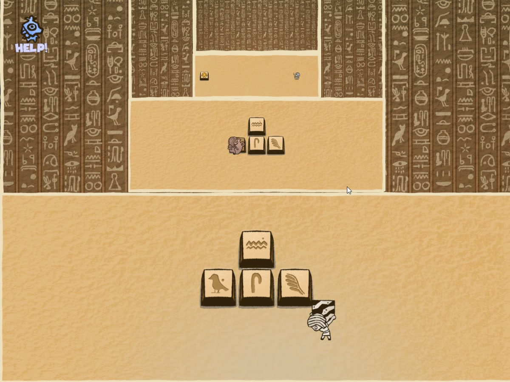

# THE KEYNG · 아래층의 입력으로 바로 위층 캐릭터 조작하기

피라미드처럼 쌓인 여러 층에서, 아래층 방향 발판을 이용해 바로 위층 캐릭터를 움직이는 2D 퍼즐입니다. 제어 발판을 발동해 다음 층을 공개하고, 방향 발판으로 위층의 길을 진행합니다.

| 항목 | 내용 |
| --- | --- |
| 팀 | 3인 · 기획 1 / 그래픽 1 / 프로그래밍 1 |
| 내 역할 | 발판 입력, 층 공개, 캐릭터 이동 명령, 최상층 클리어 흐름의 프로그래밍 |
| 기술 | Unity · C# |

[실제 플레이 · 21초](https://knugame.kr/2026/wp-content/uploads/2026/11/the-keyng-layer-controls.mp4) · [동일 영상 파일](../../media/the-keyng-layer-controls.mp4) · [전체 프로젝트 목록](../../README.md)

## 다룬 문제와 설계

발판이 있는 층과 움직일 캐릭터가 있는 층이 다릅니다. 발판은 발생한 층과 방향을 전달하고, 대상 층을 고르는 규칙은 `GameCoordinator`에 모았습니다. 목표가 항상 바로 위층인 게임 규칙에 맞춰 `fromWorldIndex + 1`로 대상을 계산합니다.

| 입력 | 전달되는 동작 |
| --- | --- |
| 제어 발판 | 현재 층의 방향 발판을 활성화하고 다음 층 공개 |
| 한 칸 이동 | 바로 위층 캐릭터에 `StepCommand` 전달 |
| 유지 입력 | 눌린 방향을 합친 벡터를 `SetRemoteDriveVector`로 전달 |
| 최상층 제어 발판 | 클리어 화면으로 전환 |

한 번 이동하는 명령과 누르는 동안의 이동을 나눴습니다. 유지 입력은 오른쪽−왼쪽, 위쪽−아래쪽으로 합쳐 반대 방향을 상쇄하고, 길이가 1보다 크면 정규화해 대각선 입력의 벡터 크기를 맞춥니다.

## 코드 읽기 시작점

[GameCoordinator.cs](../../src/the-keyng/GameCoordinator.cs)의 세 경로를 순서대로 볼 수 있습니다.

1. [HandleCtrl](../../src/the-keyng/GameCoordinator.cs#L185) — 층 공개와 최상층의 클리어 조건.
2. [HandleArrowSingle](../../src/the-keyng/GameCoordinator.cs#L224) — 입력이 발생한 층에서 바로 위층으로 한 칸 이동 전달.
3. [HandleArrowHoldChanged](../../src/the-keyng/GameCoordinator.cs#L233), [HoldState.ToVec](../../src/the-keyng/GameCoordinator.cs#L47) — 유지 입력 상태를 이동 벡터로 변환.

층마다 별도의 대상 연결 코드를 쓰지 않고 같은 인접 층 규칙을 적용합니다. 임의의 층을 고르는 방식과는 범위가 다르며, 현재 게임 규칙에 맞춘 선택입니다.

## 확인 범위

시연에는 새 층 공개와 아래층 발판을 통한 위층 캐릭터 이동이 포함됩니다. 입력 명령의 전달과 벡터 처리 기준은 위 코드에서 확인할 수 있습니다.

공개 파일은 원본의 발판·캐릭터·레이아웃 타입과 Inspector의 층 목록, 씬 설정에 의존합니다.

